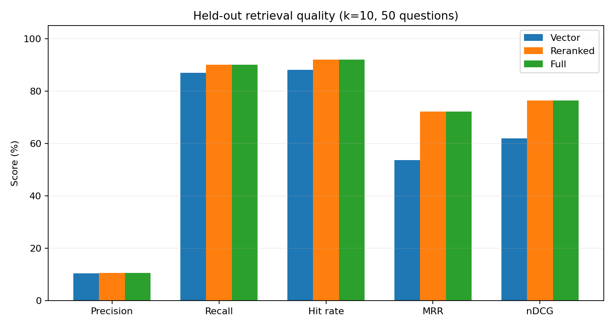
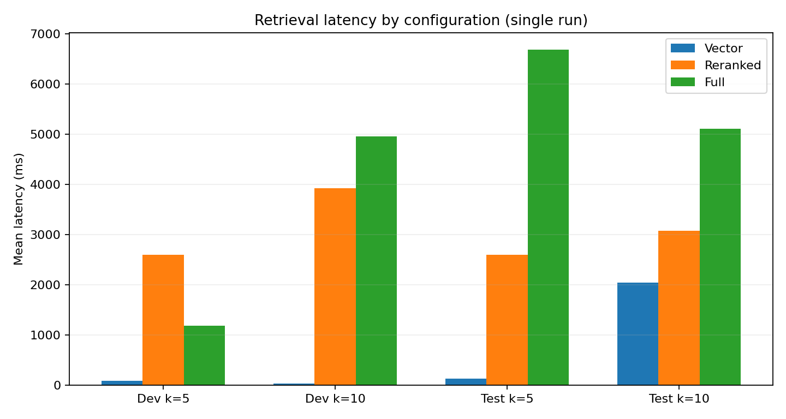
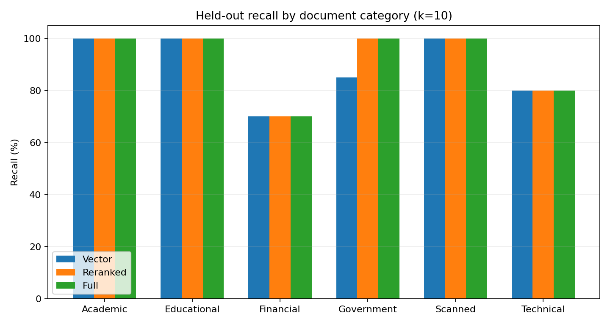

# RAG retrieval benchmark

This benchmark measures page-level retrieval quality, not generated answer correctness.

## Dataset and methodology

The shared index contains 25 PDFs and 19,570 chunks across academic, educational, financial, government, scanned and technical categories. The 80 annotated questions cover 16 documents: 30 development questions and 50 held-out questions. The remaining nine documents act as distractors. Question-source documents are disjoint between splits, but all documents are indexed together.

The evaluation compares vector search (all-MiniLM-L6-v2), cross-encoder reranking (ms-marco-MiniLM-L-6-v2), and the full pipeline (reranking plus source-quality adjustment). The candidate pool is 20 chunks at k=5 and 40 at k=10, capped by index size. Rankings are deduplicated by document and page before taking the top k. All selected runs returned k unique pages per question. Each strategy is warmed up before timing. The 12 configurations comprise 480 question-strategy-cutoff evaluations, not 480 distinct questions.

Metrics are macro-averaged across questions: precision divides the number of annotated relevant pages retrieved by k; recall divides by the number of annotated relevant pages; hit rate measures whether any annotated page was retrieved; MRR@k is the mean reciprocal rank of the first annotated relevant page (zero for misses); nDCG@k measures binary relevance with logarithmic rank discount. Latency is mean retrieval time, excluding answer generation and initial warm-up.

## Results

| Split | k | Strategy | Precision | Recall | Hit rate | MRR | nDCG | Mean latency (ms) |
| --- | ---: | --- | ---: | ---: | ---: | ---: | ---: | ---: |
| development | 5 | vector | 0.2000 | 0.8500 | 0.9000 | 0.6944 | 0.7031 | 87.46 |
| development | 5 | reranked | 0.2000 | 0.8167 | 0.8333 | 0.6472 | 0.6901 | 2594.38 |
| development | 5 | full | 0.2000 | 0.8167 | 0.8333 | 0.6472 | 0.6901 | 1184.71 |
| development | 10 | vector | 0.1100 | 0.9000 | 0.9333 | 0.6992 | 0.7236 | 29.54 |
| development | 10 | reranked | 0.1167 | 0.9500 | 0.9667 | 0.6856 | 0.7510 | 3923.30 |
| development | 10 | full | 0.1167 | 0.9500 | 0.9667 | 0.6856 | 0.7510 | 4956.05 |
| test | 5 | vector | 0.1880 | 0.7900 | 0.8200 | 0.5290 | 0.5921 | 128.88 |
| test | 5 | reranked | 0.1880 | 0.7900 | 0.8200 | 0.7023 | 0.7226 | 2594.16 |
| test | 5 | full | 0.1880 | 0.7900 | 0.8200 | 0.7023 | 0.7226 | 6689.87 |
| test | 10 | vector | 0.1040 | 0.8700 | 0.8800 | 0.5366 | 0.6190 | 2039.75 |
| test | 10 | reranked | 0.1060 | 0.9000 | 0.9200 | 0.7210 | 0.7641 | 3078.08 |
| test | 10 | full | 0.1060 | 0.9000 | 0.9200 | 0.7210 | 0.7641 | 5111.92 |







## Findings

- At k=5 on development questions, vector search had the highest recall (85%) and hit rate (90%). At k=10, reranking and the full pipeline achieved 95% recall and 96.67% hit rate.
- On held-out questions at k=5, all strategies had 79% recall and 82% hit rate, but reranking improved MRR from 0.5290 to 0.7023.
- On held-out questions at k=10, reranking improved recall from 87% to 90%, hit rate from 88% to 92% (46/50 questions), MRR from 0.5366 to 0.7210 (+34.37% relative), and nDCG from 0.6190 to 0.7641 (+23.45% relative).
- Reranked and full strategies returned identical ordered page lists in all 160 paired comparisons. No incremental ranking benefit from the source-quality adjustment was observed.
- At k=10, reranking achieved 100% annotated-page recall on the academic, educational, government and scanned test categories; technical recall was 80% and financial recall 70%. The scanned result covers only five questions on one synthetic test PDF.
- The four held-out questions with no annotated page retrieved by reranking at k=10 were Q051, Q056, Q066 and Q067 (TCP, UUID and two Toyota report questions).

## Reproduction

From the backend directory with project dependencies and Tesseract installed, collect the benchmark PDFs and build the isolated index if it does not already exist. On Windows, set `TESSDATA_PREFIX` to the installed tessdata directory if needed.

```powershell
python -m evaluation.generate_scanned_documents
python -m evaluation.collect_documents
python -m evaluation.index_benchmark
python -m evaluation.run_benchmark --strategy all --split development --k 5
python -m evaluation.run_benchmark --strategy all --split development --k 10
python -m evaluation.run_benchmark --strategy all --split test --k 5
python -m evaluation.run_benchmark --strategy all --split test --k 10
```

The indexer expects an empty benchmark collection when building a new index. Do not rebuild an existing valid index unnecessarily. Source downloads and synthetic PDF hashes may depend on availability and library versions. The collector checks document hashes against the manifest.

## Published results

`results/retrieval_comparison.csv` contains the 12 configuration summaries. `results/retrieval_summary.json` includes configuration metadata and grouped metrics. `results/per_question/` contains the selected complete-run JSON reports, including source page identifiers and individual metrics. The three earlier single-strategy development runs were excluded from the comparison to avoid duplicate configurations. Original PDFs, extracted text, model weights and the local database are not included in these published results.

## Limitations

This is a small, manually annotated benchmark, not an independent or statistically representative evaluation. Other valid answer-bearing pages may not be annotated, so a retrieval miss is not necessarily an answer failure. Precision is sensitive to the sparse page labels. The shared index means the held-out split tests held-out questions rather than indexing entirely unseen documents. The page-deduplicated evaluation differs from the application's default chunk-level retrieval. Increasing k also increases the candidate pool, so the cutoff effect cannot be isolated from candidate depth. The reported latency comes from one run per configuration, with fixed strategy order and variable machine/cache conditions; it is descriptive rather than a controlled speed benchmark. No end-to-end answer correctness, citation accuracy or hallucination rate is measured here. The observed held-out results should not be used to tune the system and then reported as an independent test of that tuned system.
